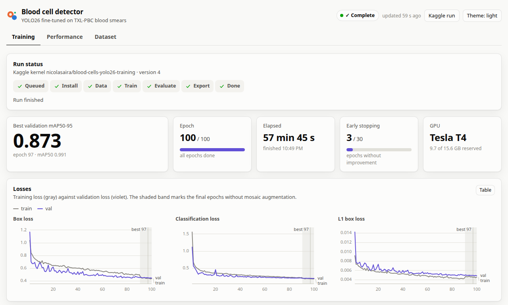
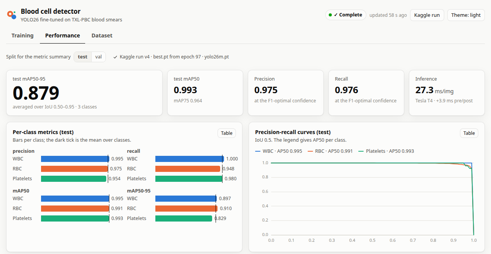
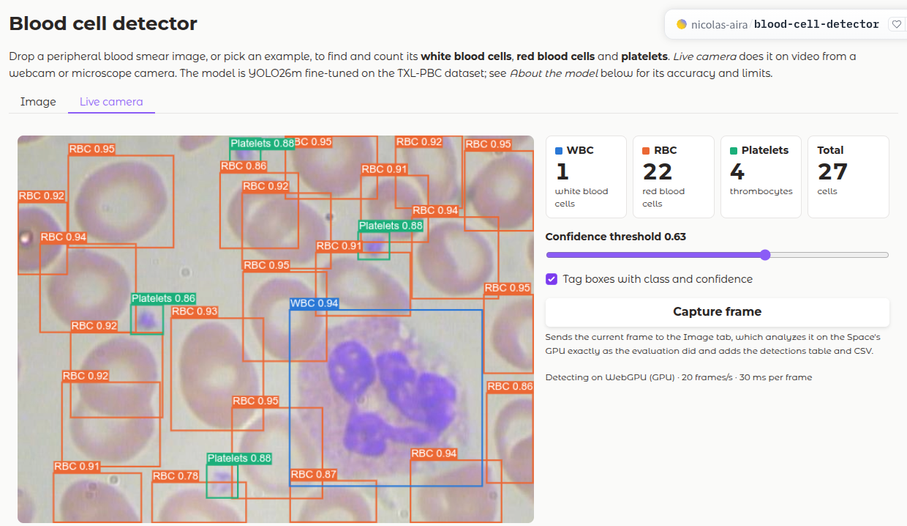
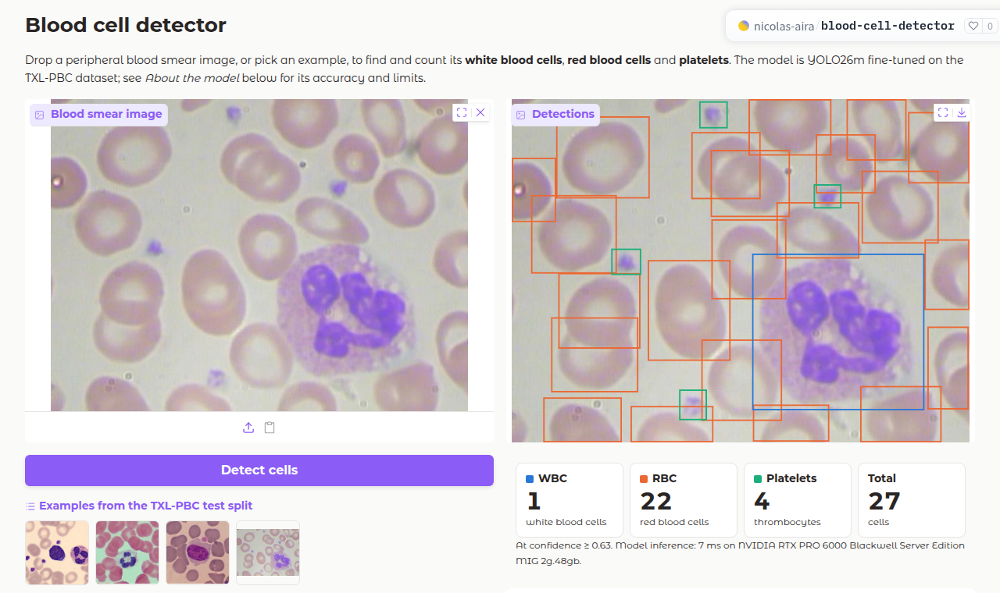
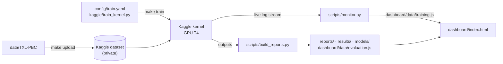

# Blood cell detection with YOLO26

Detects and classifies every cell in a peripheral blood smear image as a **white blood cell (WBC)**, **red blood
cell (RBC)** or **platelet**. A COCO-pretrained [YOLO26m](https://docs.ultralytics.com/models/yolo26/) is
fine-tuned on the TXL-PBC dataset on a Kaggle T4 GPU. An HTML dashboard follows the training live and presents the
dataset and the finished model's performance, and a web app on Hugging Face Spaces runs the model on your own
images. The dataset itself is not in this repository (see [Reproduce](#reproduce)).

## Results

On the held-out test split (126 images, 1,868 cells), with `best.pt` from epoch 97 of 100 (52 min of training on a
Kaggle T4, kernel version 4):

| Class | Precision | Recall | mAP50 | mAP50-95 |
| --- | ---: | ---: | ---: | ---: |
| WBC | 0.995 | 1.000 | 0.995 | 0.897 |
| RBC | 0.975 | 0.948 | 0.991 | 0.910 |
| Platelets | 0.954 | 0.980 | 0.993 | 0.829 |
| **All classes** | **0.975** | **0.976** | **0.993** | **0.879** |

Precision and recall are Ultralytics' values at the F1-optimal confidence. Validation mAP50-95 is 0.874, so the
model holds up on unseen images. At the operating threshold chosen on the validation split (confidence ≥ 0.63), the
WBC count is exact in all 126 test images, the RBC count is off by 0.63 cells per image on average (4.4%), and the
platelet count by 0.04. Inference takes about 27 ms per image on a T4, plus 4 ms of pre- and post-processing.

The dashboard's Training tab follows a run live, and its Performance tab presents the finished model:





## Web app

**[huggingface.co/spaces/nicolas-aira/blood-cell-detector](https://huggingface.co/spaces/nicolas-aira/blood-cell-detector)**:
drop or paste a blood smear image, or pick one of four test images, and the app draws a box around every cell and
counts the WBCs, RBCs and platelets. It runs on ZeroGPU, Hugging Face's shared GPUs: each new image borrows a
GPU, and the model returns every box down to confidence 0.05. The deployed model is
[`models/yolo26m-txlpbc-mine.pt`](models/yolo26m-txlpbc-mine.pt), adapted to personal **400× and 1000× microscope
photos**. It measures red cell size, rescales to the training cell size and processes overlapping 640-pixel tiles
with [`scripts/smear.py`](scripts/smear.py). The confidence slider (default 0.42, selected on personal validation
tiles) and the display options filter stored boxes without running the model again. A table and CSV download give
the boxes in original photo pixels. *About the model* separates personal validation results from TXL-PBC test results.

The *Live camera* tab detects cells in video from a webcam or a microscope camera, as it plays. ZeroGPU cannot
serve video, because it lends a GPU per request, so this tab runs the model in the visitor's browser instead: an
ONNX export of the weights on [ONNX Runtime Web](https://onnxruntime.ai/docs/tutorials/web/), on the GPU through
WebGPU where the browser supports it and on the CPU otherwise. The first start downloads about 110 MB (model
and runtime), which the browser keeps. The live detector calibrates red cell size and uses overlapping tiles;
*Recalibrate* repeats the measurement after changing microscope objectives. Frame rate depends on the number of
tiles and device. Its smaller calibration input and approximate field mask can produce different counts from
the full photo pipeline. Frames stay in the browser; *Capture frame* sends the current one to the *Image* tab.





The original TXL-PBC evaluation above describes the base model. Personal validation results for the fine-tuned
model are in [`results/finetune.json`](results/finetune.json); whole-photo and live-camera accuracy have not been
measured independently. The app also has an API endpoint:

```python
from gradio_client import Client, handle_file

client = Client("nicolas-aira/blood-cell-detector")
result = client.predict(handle_file("smear.png"), 0.42, api_name="/detect")  # image, confidence threshold
result["model"]       # "yolo26m-txlpbc-mine"
result["counts"]      # {"WBC": ..., "RBC": ..., "Platelets": ..., "total": ...}
result["detections"]  # [{"class": "WBC", "confidence": 0.923, "box": [x1, y1, x2, y2]}, ...] in image pixels
```

The app is [`space/app.py`](space/app.py), and the live camera tab's code is [`space/live.js`](space/live.js).
`make deploy-app` stages them in `build/space/` with the weights, their ONNX export (cached in `build/onnx/`), the
inference settings and test metrics (`model_info.json`, generated from `config/train.yaml` and `results/`) and the
shared microscope-photo pipeline and public example images, then uploads that folder to the Space. Personal
training photos are not included. Staging needs `make setup-ml` for the export.

ZeroGPU rations GPU time per visitor and day. Visitors who are not signed in to Hugging Face get the smallest
allowance (2 minutes, and a limited number of runs), signed-in free accounts get 5 minutes and PRO accounts 40.
Past that, the app shows "ZeroGPU quota exceeded" until the allowance renews.

## What is where

| | |
| --- | --- |
| **Dashboard** | [`dashboard/index.html`](dashboard/index.html): open it in a browser (no server needed). Tabs: Training (live), Performance, Dataset |
| **Dataset report** | [`reports/dataset_report.md`](reports/dataset_report.md): splits, class balance, cell sizes, image sources, quality checks |
| **Training report** | [`reports/training_report.md`](reports/training_report.md): setup, loss and metric curves, per-class progress, timeline |
| **Evaluation report** | [`reports/evaluation_report.md`](reports/evaluation_report.md): test metrics, curves, confusion matrix, cell counting, examples |
| **Model** | [`models/yolo26m-txlpbc.pt`](models/yolo26m-txlpbc.pt): fine-tuned weights (Ultralytics format) |
| **Web app** | [Hugging Face Space](https://huggingface.co/spaces/nicolas-aira/blood-cell-detector), source in [`space/`](space/) |
| **Metrics** | [`results/metrics.json`](results/metrics.json), per-epoch [`results/results.csv`](results/results.csv), [`results/evaluation.json`](results/evaluation.json) |
| **Training config** | [`config/train.yaml`](config/train.yaml): the single source of truth for a run |

## How it works



1. **Dataset.** `scripts/analyze_dataset.py` computes statistics and quality checks and writes the dataset report.
   `scripts/kaggle_upload_dataset.py` uploads the images and labels as a **private** Kaggle dataset.
2. **Training.** `scripts/kaggle_push_kernel.py` embeds `config/train.yaml` into
   [`kaggle/train_kernel.py`](kaggle/train_kernel.py) and pushes it as a private Kaggle script with a T4 GPU and
   internet access. On Kaggle the script installs the pinned Ultralytics release, fine-tunes the model, evaluates
   `best.pt` on the validation and test splits, and predicts every validation and test image, each with a 16-pixel
   gray margin (see [Image edges](#notes-and-limitations)). Throughout, it prints one JSON progress event per line,
   prefixed with `@@BC@@`, from Ultralytics callbacks: batches, epochs with per-class metrics, stages and evaluation
   results.
3. **Monitoring.** `scripts/monitor.py` follows the kernel's live log stream (`kaggle kernels logs --follow`
   underneath), parses those events and rewrites `dashboard/data/training.js` every few seconds. The dashboard
   reloads that file, so the Training tab updates while the GPU works.
4. **Reports.** When the run completes, the monitor downloads the outputs to `runs/kaggle/v<N>/` and runs
   `scripts/build_reports.py`. The builder writes the training and evaluation reports, the evaluation data behind
   the Performance tab, `results/` and `models/`. It also re-matches the stored predictions to the ground truth at
   the operating threshold chosen on the validation split. That gives the confusion matrix, per-class
   precision/recall/F1 and per-image cell-count errors, and the dashboard redoes the same matching live for any
   threshold you pick.

## Reproduce

Requirements: Python 3.12, [uv](https://docs.astral.sh/uv/), a Kaggle account with phone verification
(needed for GPU and internet in kernels), and a copy of the TXL-PBC dataset.

The dataset is git-ignored. Put it in `data/TXL-PBC/`: `images/{train,val,test}/*.png`, a YOLO-format label file
per image in `labels/{train,val,test}/` (class 0 = WBC, 1 = RBC, 2 = Platelets), and a `data.yaml` with the split
paths and class names.

```bash
make setup                     # .venv with the Kaggle client, plotting and report dependencies
cp .env.example .env           # then paste your token: kaggle.com -> Settings -> API -> Generate New Token
make dataset-report            # dataset statistics, figures and dashboard data
make upload                    # private Kaggle dataset <user>/txl-pbc-blood-cells
make train                     # push the kernel and start a GPU run (about an hour on a T4)
make monitor                   # opens the dashboard and follows the run; builds the reports at the end
```

`make reports` rebuilds the reports from downloaded outputs, and `make dashboard` opens the dashboard again later.
`make help` lists every target.

Optional local tools need PyTorch, Ultralytics and Gradio (`make setup-ml`):

```bash
make smoke                                    # 2-epoch CPU run of the whole Kaggle job, before spending GPU quota
make predict SOURCE=path/to/your/images       # counts per image, annotated images and counts.csv in predictions/
make app                                      # local NVIDIA GPU web app at http://127.0.0.1:7860
make app-cpu                                  # explicit CPU fallback
```

The local app defaults to `models/yolo26m-txlpbc-mine.pt` through PyTorch for **both images and live camera**.
Use **Cell detector model** in either tab to switch between the microscope fine-tune
(`yolo26m-txlpbc-mine.pt`, the default) and **Original YOLO26 (TXL-PBC)** (`yolo26m-txlpbc.pt`).
Both use the microscope tiling pipeline, and switching keeps the current detection confidence threshold.
Photo results are recomputed for the new detector; live switching resets tracks and cell-size calibration.
Captured frames inherit the live detector selection. The separate WBC subtype classifier stays the same.
CSV exports include a `detector model` column identifying which weights produced the result.
Photos and video frames stay on this computer. Live video reuses the measured red cell size between frames;
click *Recalibrate* after changing microscope objectives. The app displays the active GPU and model.
*Stabilize detections* is enabled by default: cells are associated across frames, boxes and scores are smoothed,
new detections need two observations, and brief misses persist for at most 0.4 seconds. Established cells use a
small confidence buffer to reduce blinking around the threshold. Confidence tags marked ≈ are smoothed values;
live counts use the same stabilized tracks. This adds a short delay when cells appear or disappear. Turn it off
for raw detections; *Capture frame* and image/API results remain independent measurements.
`make app` requires CUDA and reports an error if it is unavailable. Install CUDA-enabled PyTorch with
`make setup-gpu` when setting up a new machine. Use `make app APP_PORT=7861` to choose a different port,
or `.venv/bin/python scripts/run_app.py --open` to open the browser automatically. Stop a foreground run with
Ctrl+C. The local app is staged separately in `build/local/` and needs no ONNX export or Hugging Face login.

### WBC subtype classifier

`make train-wbc` trains a separate ResNet-18 on the local CUDA GPU using `data/bloodmnist` and
[`config/wbc.yaml`](config/wbc.yaml). It classifies six WBC categories: basophil, eosinophil, immature
granulocytes, lymphocyte, monocyte and neutrophil. Erythroblasts and platelets are excluded. Exact duplicates
are removed across splits and conflicting labels are quarantined in generated manifests; source images are
unchanged. Validation macro-F1 selects the checkpoint, and the test split is evaluated afterward.

The checkpoint is [`models/resnet18-bloodmnist-wbc.pt`](models/resnet18-bloodmnist-wbc.pt), with metrics in
[`results/wbc_classification.json`](results/wbc_classification.json) and a
[classification report](reports/wbc_classification_report.md). Resume interrupted training with
`.venv/bin/python scripts/train_wbc.py --resume`.

```bash
make predict-wbc SOURCE=path/to/cropped_wbc.png
```

This takes a **single-WBC crop**, rather than a whole microscope photo. It has no unknown/non-WBC class.
The native BloodMNIST crops are 64×64 pixels; accuracy on personal microscope crops has not been measured.
The web app loads both models: detected WBCs are cropped with a small context margin, then classified on the GPU.
The Image tab adds subtype labels, a subtype count breakdown, and separate subtype/confidence columns in its
table and CSV. **WBC subtype confidence** controls when a result is shown as *Uncertain*; its default of 0.70
is a display threshold, not a calibrated guarantee. Changing it reuses cached photo predictions.

Local live camera uses the classifier on the same GPU, with subtype probabilities smoothed across cell tracks.
Its subtype threshold is separate from the detector threshold. On the hosted app, capture a frame to obtain
subtype analysis in the Image tab. These whole-photo and live subtype predictions have not been validated on
personal microscope images.

The local `/detect_with_model` API takes an image, detection confidence, and detector ID (`microscope` or
`original`). Existing `/detect` calls retain the microscope detector as their default. Local `/detect_live`
accepts an optional detector ID as its fourth input, after the cached red-cell size.

`make deploy-app` deploys the web app to `<your user>/blood-cell-detector` on Hugging Face, creating the Space with
ZeroGPU hardware the first time. It needs `hf auth login`, or `HF_TOKEN` in `.env`, with write access. A free
account can host 2 ZeroGPU Spaces. Pass `--repo-id` or `--private` to `scripts/deploy_space.py` for another name or
a private Space.

## Training setup

| | |
| --- | --- |
| Model | `yolo26m.pt`, COCO-pretrained; 75 GFLOPs at 640 px |
| Parameters | 21.8 M, all trained (no frozen layers). All but 4.6 K start from the COCO weights: the class-score output layers are re-initialized for 3 classes instead of 80. Inference uses 20.4 M, because Ultralytics folds batch norm into the convolutions and keeps only one of the model's two detection heads (NMS or NMS-free) |
| Data | TXL-PBC: 882 train / 252 val / 126 test images; 3 classes |
| Resolution | 640 px, which is the largest native image size (640×480), so nothing is downscaled |
| Optimizer | AdamW, lr0 0.001 with linear decay, 3 warm-up epochs: Ultralytics' recommendation for datasets under 1,000 images |
| Schedule | up to 100 epochs, early-stopping patience 30, batch 16 |
| Augmentation | mosaic (off for the final 10 epochs), horizontal **and vertical** flips (smears have no canonical orientation), scale and translation, HSV jitter; no rotation, which would inflate axis-aligned boxes |
| Hardware | Kaggle "GPU T4 ×2" session, using one T4. Custom Ultralytics callbacks do not reach DDP worker processes, and a single T4 trains an epoch in about 30 s |
| Software | Ultralytics 8.4.198 on Kaggle's PyTorch image |

## Repository layout

```text
config/train.yaml           run configuration (model, hyperparameters, Kaggle settings)
kaggle/train_kernel.py      the job that runs on Kaggle (train, evaluate, export, progress events)
scripts/
  analyze_dataset.py        dataset statistics, quality checks, dataset report
  kaggle_upload_dataset.py  private Kaggle dataset create/version
  kaggle_push_kernel.py     render and push the kernel, record the run in runs/current_run.json
  monitor.py, run_state.py  live log streaming -> dashboard/data/training.js
  build_reports.py          training/evaluation reports, results/, models/, dashboard/data/evaluation.js
  predict.py                local inference with the trained weights
  deploy_space.py           stage the web app in build/space and deploy it to Hugging Face Spaces
  common.py, plotting.py    shared paths, helpers and figure styling
dashboard/                  index.html, app.js, styles.css and the generated data/*.js
space/                      the web app: app.py (Gradio + ZeroGPU), live.js (live camera tab, in-browser
                            ONNX Runtime Web), requirements.txt, README.md (Space card)
reports/                    Markdown reports and their figures
results/, models/           headline metrics, per-epoch CSV, evaluation details, weights
data/TXL-PBC/               the dataset (images/, labels/, data.yaml); not in the repository
```

`.env`, `.venv/`, `data/` (the dataset), `build/` (staged Kaggle bundles and web app), `runs/` (raw Kaggle downloads), `smoke/`
and `predictions/` are git-ignored.

## Notes and limitations

- **Run history.** All four kernel versions trained this configuration to identical weights, because training is
  deterministic: best epoch 97, validation mAP50-95 0.873 and the same test metrics. Versions 1 and 2 then crashed
  with a CUDA out-of-memory error in the last step, predicting the validation images. The kernel passed the images
  as a list of paths, which Ultralytics runs as one batch whatever `batch` says, so all 252 images went through the
  network at once. Version 3 predicted in batches of 16 and completed. Its results showed the image-edge effect
  described next, so version 4 added the gray margin; it produced the published results.
- **Image edges.** TXL-PBC mostly leaves cells cut off at the image edge unannotated, although some images do label
  them. The model reports many such cells when the image edge is also the edge of the network input, as with a plain
  `model.predict`, and few when the image has a gray border, as in Ultralytics' validation. So every prediction here,
  including `scripts/predict.py`, adds a 16-pixel margin first. On the test split at the operating threshold, the
  margin cuts false RBC detections from 179 to 50 (RBC F1 from 0.933 to 0.967) and the RBC count bias from +0.99 to
  −0.09 cells per image, at the cost of 7 more missed cells.
- **Data quality.** Every image has a label file and every row is well formed. 47 repeated label rows are dropped,
  as Ultralytics does. 5 validation images show the same cell as a training image, imaged twice, so validation
  metrics are slightly optimistic; the **test split has no such overlap**. See the dataset report.
- **Scope.** TXL-PBC merges several public collections (five image resolutions), and the test images come from the
  same sources. Performance on smears from another lab, stain or scanner has to be measured there. The model counts
  three broad classes. It does not tell WBC subtypes apart and is not a validated diagnostic device.
- **Dataset licence.** No licence ships with this copy of TXL-PBC, so its images and labels are not part of this
  repository. The [original release](https://github.com/lugan113/TXL-PBC_Dataset) is under the MIT License and
  asks to be cited (Gan, Li & Wang, *Sci Data* 12, 1694, 2025). The web app ships four of its test images as
  examples, with that citation. The four sources TXL-PBC merges have their own terms.
