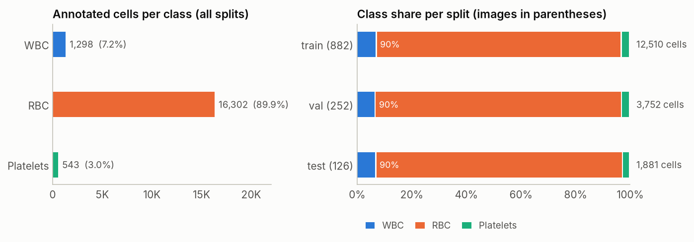
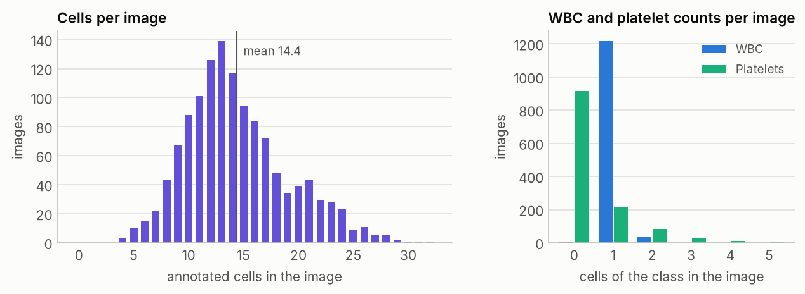
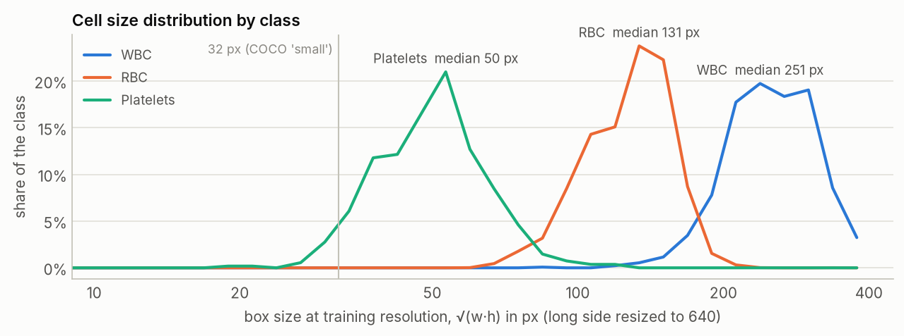
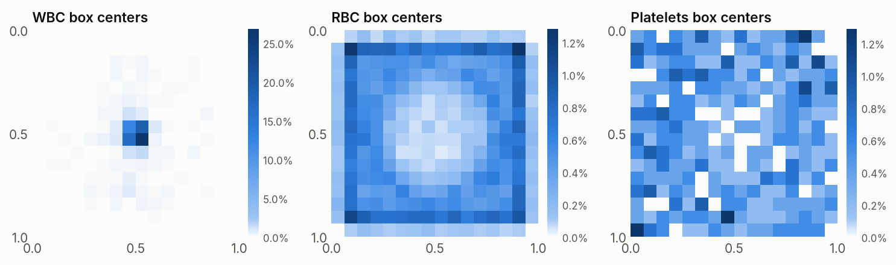
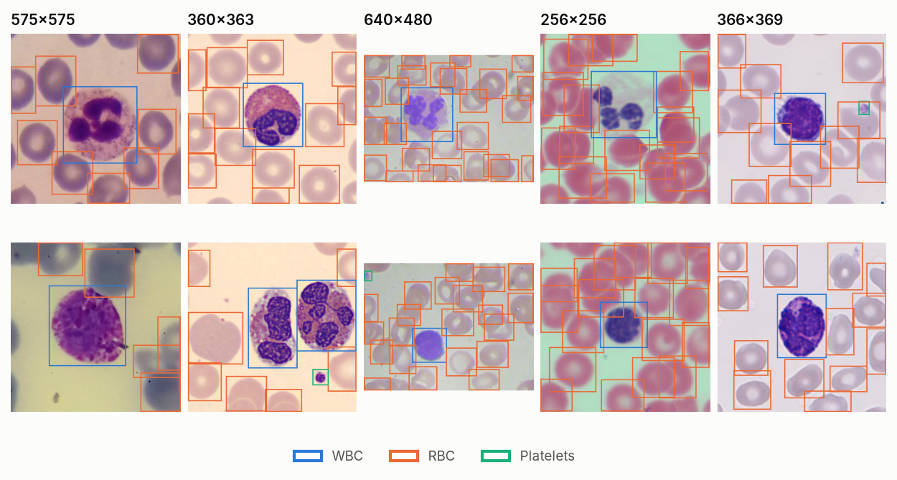

# TXL-PBC dataset report

_Generated by `scripts/analyze_dataset.py` on 2026-11-02. Interactive version: the **Dataset** tab of the dashboard._

## Summary

- **1,260 images** with **18,143 annotated cells** in 3 classes, split 882 / 252 / 126 (70% / 20% / 10%) into train / val / test.
- **Strong class imbalance:** RBC 89.9%, WBC 7.2%, platelets 3.0% of all cells. The class mix is nearly identical in every split, so validation and test results are comparable.
- **Platelets are both rare and small**: median 50 px at training resolution, 4% below 32 px. WBC are the largest (median 251 px), RBC sit in between (131 px).
- **5 image resolutions**, a sign that TXL-PBC merges several source collections with different microscopes and magnifications (see *Image sources*).
- **Quality checks:** 6 pass, 2 warn (details below).

## Splits and classes

| Split | Images | WBC | RBC | Platelets | Cells | Cells per image (mean · min–max) |
| --- | ---: | ---: | ---: | ---: | ---: | --- |
| train | 882 | 908 | 11,220 | 382 | 12,510 | 14.18 · 4–32 |
| val | 252 | 257 | 3,383 | 112 | 3,752 | 14.89 · 5–31 |
| test | 126 | 133 | 1,699 | 49 | 1,881 | 14.93 · 5–28 |
| **total** | **1,260** | **1,298** | **16,302** | **543** | **18,143** | |

## Cells per image

Images hold 4–32 cells. WBC appear in 1,255 images (100%), usually exactly one per image; platelets appear in only 343 images (27%).

## Cell sizes

Sizes are the geometric mean of box width and height, measured after resizing each image so its long side is 640 px, which is the resolution the model trains at.

| Class | Median | 5th–95th percentile | Below 32 px | Native median | Median aspect (w/h) |
| --- | ---: | --- | ---: | ---: | ---: |
| WBC | 251 px | 177–345 px | 0% | 184 px | 0.99 |
| RBC | 131 px | 89–168 px | 0% | 87 px | 1.00 |
| Platelets | 50 px | 33–73 px | 4% | 34 px | 1.00 |

## Image sources

Image size identifies the source collection. Smaller images are upscaled to 640 px on the long side for training (column *scale*).

| Resolution | Images (train / val / test) | Color mode | Scale to 640 | Cells per image | Median WBC / RBC / platelet size at 640 |
| --- | --- | --- | ---: | ---: | --- |
| 575×575 | 500 (358 / 98 / 44) | RGB (500) | ×1.11 | 11.4 | 292 / 143 / 60 px |
| 360×363 | 486 (340 / 97 / 49) | RGB (486) | ×1.76 | 14.4 | 242 / 131 / 54 px |
| 640×480 | 160 (101 / 41 / 18) | RGB (160) | ×1.0 | 21.9 | 207 / 99 / 40 px |
| 256×256 | 100 (70 / 16 / 14) | RGBA (100) | ×2.5 | 17.4 | 234 / 147 / 46 px |
| 366×369 | 14 (13 / 0 / 1) | RGB (14) | ×1.73 | 13.4 | 216 / 134 / 66 px |

## Spatial distribution

Where box centers fall inside the image (normalized coordinates, darker means more boxes). 90% of WBC centers lie in the central quarter of the image area, against 11% of RBC and 17% of platelets. Many source images are crops centered on one white cell, so position alone predicts the WBC class. Mosaic and flip augmentation break that shortcut during training.

## Data quality checks

| Check | Result | Detail |
| --- | --- | --- |
| Every image has a label file and every label file an image | ✅ pass | 1,260 images checked |
| Label rows are well formed (5 numeric fields, class 0–2, normalized coordinates) | ✅ pass | 18,143 rows parsed |
| No image without annotations | ✅ pass | every image has at least one annotated cell |
| Boxes stay inside the image | ✅ pass | no box overhangs the border |
| No duplicate boxes within an image | ⚠️ warning | 47 repeated rows |
| No exact duplicate images | ✅ pass | pixel hashes are unique |
| No near-duplicate images across splits (dHash distance ≤ 9/64) | ⚠️ warning | 5 pairs show the same cell imaged twice (train ↔ val: 5); the test split has none |
| Alpha channels are fully opaque, so loading as RGB loses nothing | ✅ pass | 100 RGBA images, all opaque |

- **Repeated label rows** are harmless for training: Ultralytics drops exact duplicate rows when it caches the labels. The local evaluation code de-duplicates them the same way.
- **Near-duplicates:** these pairs show the same cell and the same neighboring cells, captured twice with a slightly different focus, framing or color balance (likely two cameras in a source collection). Such validation images make validation metrics slightly optimistic. The test split has no such pair, so the final test metrics are unaffected.

## Sample images

Two random images per resolution with their ground-truth boxes (blue WBC, orange RBC, aqua platelets).

## What this means for training

- **Resolution:** `imgsz=640` matches the largest native size (640×480). Nothing is downscaled, and the small sources are upscaled, which helps platelets.
- **Imbalance:** platelets are about 3% of cells and the smallest objects, so expect their AP to trail the other classes. Per-class metrics are tracked every epoch for this reason.
- **Augmentation:** smears have no canonical orientation, so both horizontal and vertical flips preserve the labels. Mosaic places cells at new positions and scales, which counters any framing bias visible in the box-center maps.
- **Evaluation:** the split is fixed by the dataset and the class mix is stable across splits. Model selection uses `val`; `test` is only used for the final numbers.
