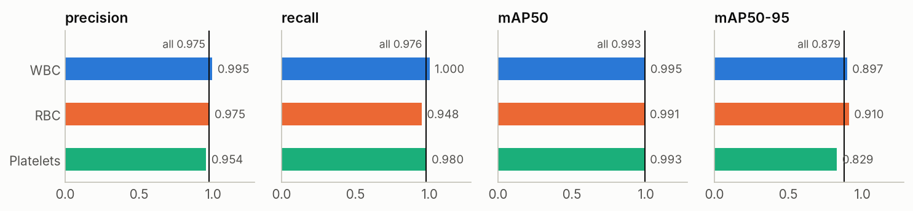
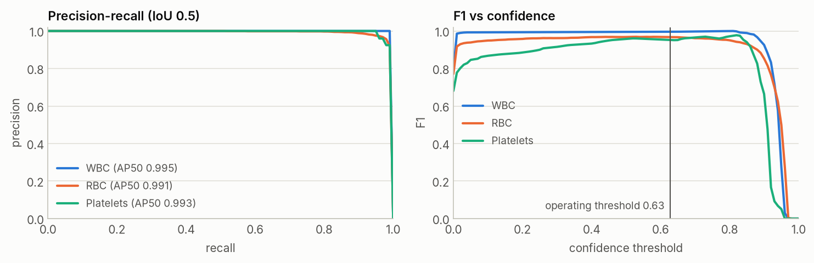
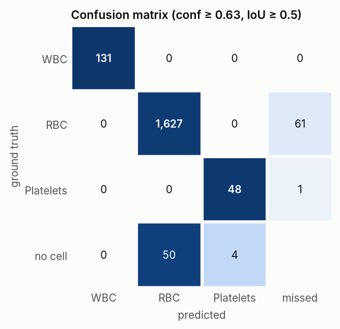
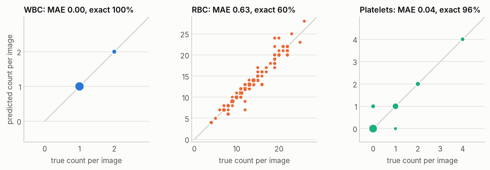
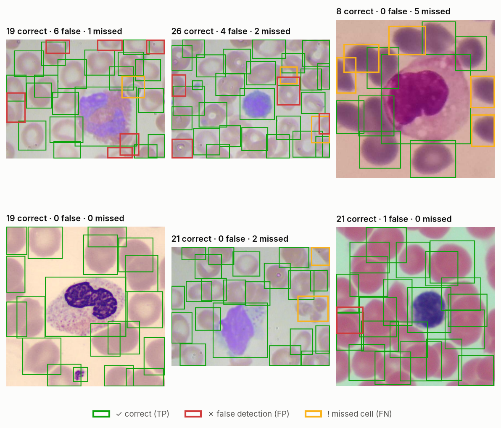

# Evaluation report: YOLO26M on TXL-PBC

_Kaggle kernel [`nicolasaira/blood-cells-yolo26-training`](https://www.kaggle.com/code/nicolasaira/blood-cells-yolo26-training) version 4 · generated 2026-11-02. Interactive version with a prediction explorer: the **Performance** tab of the dashboard._

All numbers come from the held-out **test** split (126 images, 1,868 cells after dropping 13 repeated label rows), which played no part in training or model selection, unless stated otherwise. The model is `best.pt`, the epoch with the highest validation mAP50-95.

## Summary

- **mAP50 0.993 · mAP50-95 0.879** on test, with precision 0.975 and recall 0.976 at the F1-optimal confidence.
- Per class (mAP50-95): WBC 0.897, RBC 0.910, Platelets 0.829.
- At the operating threshold **conf ≥ 0.63**, chosen on the validation split by maximum F1, F1 is WBC 1.000, RBC 0.967, Platelets 0.950. The remaining errors are 62 missed cells, 54 extra detections and 0 cells found but given the wrong class.
- **Cell counting:** the WBC count is exact in 100% of images. The RBC count is off by 0.63 cells per image on average (MAE; 4.4% relative), and the platelet count by 0.04.
- **Speed:** 27.3 ms per image for inference on a Kaggle Tesla T4 (+2.5 ms pre-processing, +1.4 ms NMS and post-processing) at 640 px, measured during batched validation.

## Test metrics per class

Ultralytics metrics: precision and recall at the confidence that maximizes the mean F1; AP over the full confidence range.

| Class | Images | Cells | Precision | Recall | F1 | mAP50 | mAP75 | mAP50-95 |
| --- | ---: | ---: | ---: | ---: | ---: | ---: | ---: | ---: |
| WBC | 126 | 131 | 0.995 | 1.000 | 0.997 | 0.995 | 0.995 | 0.897 |
| RBC | 126 | 1,688 | 0.975 | 0.948 | 0.961 | 0.991 | 0.966 | 0.910 |
| Platelets | 34 | 49 | 0.954 | 0.980 | 0.967 | 0.993 | 0.930 | 0.829 |
| **all** | 126 | 1,868 | **0.975** | **0.976** | | **0.993** | **0.964** | **0.879** |

## Validation versus test

| Split | Precision | Recall | mAP50 | mAP75 | mAP50-95 |
| --- | ---: | ---: | ---: | ---: | ---: |
| val | 0.981 | 0.958 | 0.991 | 0.965 | 0.874 |
| test | 0.975 | 0.976 | 0.993 | 0.964 | 0.879 |

Test mAP50-95 is 0.005 above validation. The model generalizes from the validation split to unseen test images. Both rows validate `best.pt` in full precision. The training report's validation figures were measured during training in mixed precision, so they can differ in the third decimal.

## Precision-recall and F1 curves

## Operating threshold

Deploying the detector requires one confidence threshold. Maximizing F1 on the **validation** split gives **0.63**. Applying it to test, a detection is correct when it overlaps a cell of the same class with IoU ≥ 0.5:

| Class | Correct (TP) | False detections (FP) | Missed (FN) | Precision | Recall | F1 |
| --- | ---: | ---: | ---: | ---: | ---: | ---: |
| WBC | 131 | 0 | 0 | 1.000 | 1.000 | 1.000 |
| RBC | 1,627 | 50 | 61 | 0.970 | 0.964 | 0.967 |
| Platelets | 48 | 4 | 1 | 0.923 | 0.980 | 0.950 |

These detections, like those behind the confusion matrix, the counts, the examples and the dashboard explorer, come from the inference that `scripts/predict.py` uses: each image first gets a 16-pixel gray margin at the network's 640 px scale, about what Ultralytics' validation adds. Without it, the model also reports cells cut off at the image edge, which the annotators left out.

## Confusion matrix

Class-agnostic matching at the operating threshold. Rows are the annotated class; *no cell* collects detections without a matching annotation, and *missed* collects annotated cells without a detection. Shading is the share of the row.

## Cell counting

Blood counts are often what matters downstream, so this section compares the number of detected cells per image with the annotated number, at the operating threshold.

| Class | Annotated | Detected | MAE per image | Bias per image | Relative error | Exact count | Within ±1 | Pearson r |
| --- | ---: | ---: | ---: | ---: | ---: | ---: | ---: | ---: |
| WBC | 131 | 131 | 0.00 | +0.00 | 0.0% | 100% | 100% | 1.000 |
| RBC | 1,688 | 1,677 | 0.63 | -0.09 | 4.4% | 60% | 87% | 0.971 |
| Platelets | 49 | 52 | 0.04 | +0.02 | 2.9% | 96% | 100% | 0.969 |

## NMS-free head

YOLO26 also has a one-to-one head that needs no non-maximum suppression (`nms=False`). The default path above uses the one-to-many head with NMS. On the same test images:

| Head | Precision | Recall | mAP50 | mAP50-95 | Inference + post-processing (ms/img) |
| --- | ---: | ---: | ---: | ---: | ---: |
| one-to-many + NMS (default) | 0.975 | 0.976 | 0.993 | 0.879 | 28.7 |
| one-to-one, NMS-free | 0.965 | 0.976 | 0.991 | 0.878 | 27.7 |

## Examples

Test images with the most errors (top row) and a random selection (bottom row), at the operating threshold. Green boxes are correct detections, red boxes false detections, and yellow boxes annotated cells the model missed.

## Limitations

- TXL-PBC merges several public collections, so the test images come from the same sources and microscopes as the training images. Accuracy on smears from a new lab, stain or scanner is unknown until it is measured there.
- Ground truth is one annotation per cell with no inter-annotator agreement, so part of the residual error, especially for overlapping RBC and tiny platelets, is label noise.
- The model detects and counts three broad classes. It does not tell WBC subtypes apart and is not a validated diagnostic device.
