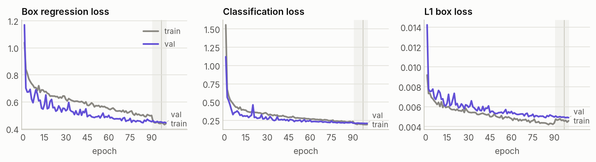
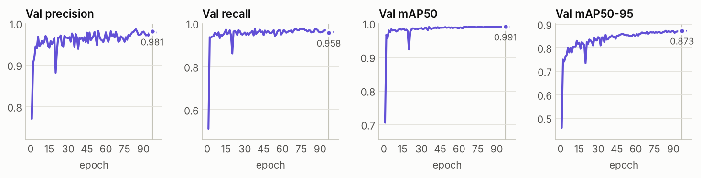
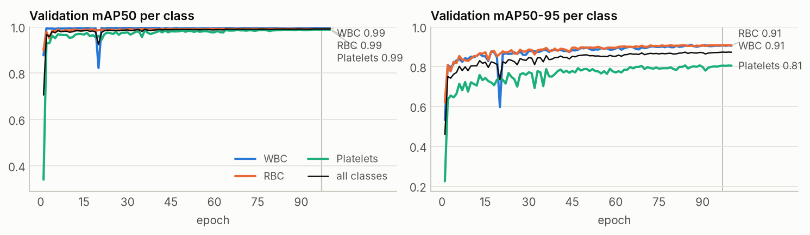
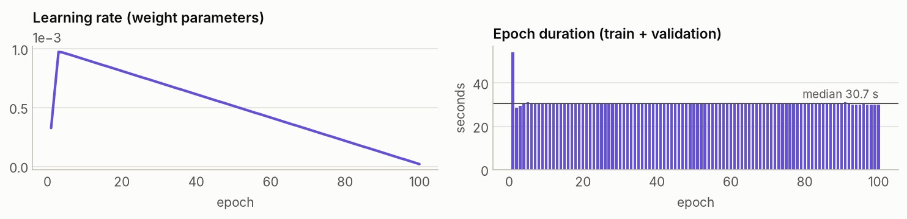

# Training report: YOLO26M on TXL-PBC

_Kaggle kernel [`nicolasaira/blood-cells-yolo26-training`](https://www.kaggle.com/code/nicolasaira/blood-cells-yolo26-training) version 4 · generated 2026-11-02. Live and interactive version: the **Training** tab of the dashboard._

## Summary

- Fine-tuned **yolo26m.pt** (COCO-pretrained) on a **Tesla T4** in **51 min 42 s**, training all 21.8 M parameters of the 3-class model (75 GFLOPs at 640 px); all 100 planned epochs ran.
- **Best epoch 97:** validation mAP50-95 **0.873**, mAP50 **0.991**, precision 0.981, recall 0.958. These weights are the deliverable (`best.pt`).
- Per-class mAP50-95 at the best epoch: WBC 0.907, RBC 0.908, Platelets 0.805.
- Validation box loss reached its minimum at epoch 98 and ended within 0.1% of it, so there is no sign of overfitting.

## Setup

| Setting | Value |
| --- | --- |
| Model | `yolo26m.pt` (YOLO26, NMS-free capable head, no DFL), COCO-pretrained |
| Data | TXL-PBC: 882 train / 252 val images |
| Image size · batch | 640 px · 16 (56 iterations per epoch) |
| Optimizer | AdamW, lr0 0.001, linear decay to lr0×0.01, 3 warm-up epochs, weight decay 0.0005 |
| Epochs | 100 planned, early-stopping patience 30 |
| Augmentation | mosaic 1.0 (off for the last 10 epochs), flips LR 0.5 / UD 0.5, scale ±0.5, translate ±0.1, HSV 0.015/0.7/0.4, no rotation or mixup |
| Precision | mixed precision (AMP), seed 42, deterministic |
| Hardware | Kaggle Tesla T4 (15.6 GB), 4 vCPUs; one GPU of the T4 ×2 session is used |
| Software | Python 3.13.15, PyTorch 2.11.0+cu128, CUDA 12.8, Ultralytics 8.4.198 |

## Losses

YOLO26 trains two detection heads together: one-to-many, used with NMS, and one-to-one, NMS-free. The optimized loss is a weighted sum of both, and the weight moves from the one-to-many head (0.8 in the first epoch) to the one-to-one head (0.9 by the last planned epoch). Ultralytics logs the one-to-one head's losses, which are the curves below. The gray band marks the final epochs without mosaic augmentation, and the vertical line marks the best epoch.

## Validation metrics

| Epoch | Precision | Recall | mAP50 | mAP50-95 |
| --- | ---: | ---: | ---: | ---: |
| 1 | 0.771 | 0.513 | 0.706 | 0.460 |
| 25 | 0.948 | 0.969 | 0.984 | 0.825 |
| 50 | 0.969 | 0.956 | 0.988 | 0.859 |
| 97 (best) | 0.981 | 0.958 | 0.991 | 0.873 |
| 100 (last) | 0.979 | 0.961 | 0.991 | 0.873 |

## Per-class progress

Platelets is the hardest class at the best epoch (mAP50-95 0.805). The dataset report explains why: platelets are the rarest and smallest cells.

## Learning rate and epoch time

## Run timeline

| Stage | Started | Duration |
| --- | --- | --- |
| queued on Kaggle | 2026-11-02 20:51:43 UTC | 3 s |
| install | 2026-11-02 20:51:46 UTC | 12 s |
| data | 2026-11-02 20:51:58 UTC | 4 min 49 s |
| train | 2026-11-02 20:56:47 UTC | 52 min 06 s |
| evaluate | 2026-11-02 21:48:53 UTC | 38 s |
| export | 2026-11-02 21:49:31 UTC | 0 s |

## Artifacts

- Weights: [`models/yolo26m-txlpbc.pt`](../models/yolo26m-txlpbc.pt) (44.0 MB)
- Per-epoch metrics: [`results/results.csv`](../results/results.csv); progress events: [`results/events.jsonl`](../results/events.jsonl)
- Training configuration: [`config/train.yaml`](../config/train.yaml)
