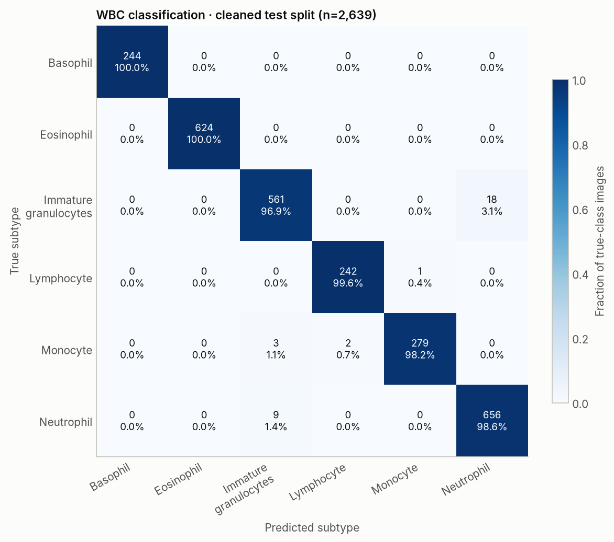
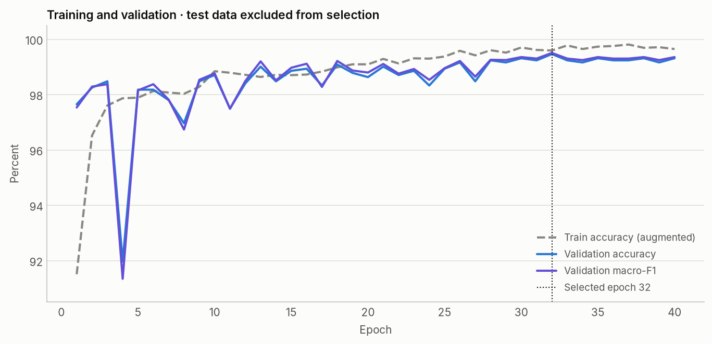

# WBC subtype classifier

Trained locally on **NVIDIA GeForce RTX 3070 Laptop GPU**, using the supplied `data/bloodmnist` images.
The deliverable is [`models/resnet18-bloodmnist-wbc.pt`](../models/resnet18-bloodmnist-wbc.pt): a six-class ResNet-18 initialized with
Torchvision's ImageNet-1K V1 weights. This is a second-stage classifier for one cropped WBC at a time.

## Held-out results

The selected checkpoint (epoch **32** of 40 completed epochs)
classifies **2,606/2,639** cleaned test crops correctly:
**accuracy 98.75%**, **macro-F1 98.95%**,
balanced accuracy 98.89%. Validation accuracy is 99.47%,
with macro-F1 99.51%. The test split was evaluated after checkpoint selection.

| Subtype | Test images | Precision | Recall | F1 |
| --- | ---: | ---: | ---: | ---: |
| Basophil | 244 | 100.00% | 100.00% | 100.00% |
| Eosinophil | 624 | 100.00% | 100.00% | 100.00% |
| Immature granulocytes | 579 | 97.91% | 96.89% | 97.40% |
| Lymphocyte | 243 | 99.18% | 99.59% | 99.38% |
| Monocyte | 284 | 99.64% | 98.24% | 98.94% |
| Neutrophil | 665 | 97.33% | 98.65% | 97.98% |

There are 33 test errors. Largest off-diagonal counts: Immature granulocytes → Neutrophil: 18; Neutrophil → Immature granulocytes: 9; Monocyte → Immature granulocytes: 3; Monocyte → Lymphocyte: 2.



## Data and leakage checks

The six WBC categories are basophil, eosinophil, immature granulocytes, lymphocyte, monocyte and neutrophil.
Erythroblast and platelet images are excluded because they are not WBC subtypes. The immature granulocyte
label is a group, not a separate prediction for each maturation stage.

The source's train/validation/test split is retained. Pixel-hash auditing found 17
exact duplicate groups, 9 spanning splits, and
1 group with conflicting labels. All copies of the conflicting-label image
are quarantined. Other duplicate groups contribute one copy, preferring test over validation over training.
This excludes 18 entries from the training/evaluation manifests. Source files are unchanged.

The resulting splits have **9,215 train / 1,321 validation / 2,639 test** images.
No exact pixel hash occurs in multiple cleaned splits. These are cleaned, WBC-only results and are not the
standard eight-class BloodMNIST benchmark. Patient-level separation and near-duplicate overlap are unknown.

The full audit, exclusions, per-file hashes and manifests are under
`runs/wbc/resnet18-bloodmnist-wbc/`. Manifest SHA-256: `f43da2eb57c7dfbebd4520eb2fa0119c78a1c198d8f023636d69676b213f3806`.

## Training and reproduction

Native images are RGB **64×64**. They are resized bilinearly to **128×128**
and normalized with ImageNet mean/std; resizing does not restore missing detail. All network layers are trained.
Training augmentation uses horizontal/vertical flips, rotations up to 180°, and mild brightness/contrast/color
variation. Validation and test use resizing and normalization only, without test-time augmentation.

Loss is class-weighted cross-entropy using inverse training frequencies, with label smoothing
0.05. AdamW uses backbone learning rate 0.0003,
head learning rate 0.001, weight decay 0.0001,
2 warm-up epochs and cosine decay. Batch size is 96;
early-stopping patience is 10. The checkpoint maximizes **validation macro-F1**.
Seed: 42. PyTorch 2.14.1+cu126,
Torchvision 0.29.1+cu126, CUDA 12.6.
Training uses mixed precision; final validation, test predictions and the inference loader use FP32.
This invocation took 3.7 minutes for training and final evaluation.



```bash
make train-wbc
# Resume an interrupted run:
.venv/bin/python scripts/train_wbc.py --resume
# Classify a crop containing a single WBC:
make predict-wbc SOURCE=path/to/wbc_crop.png
```

Training config: [`config/wbc.yaml`](../config/wbc.yaml).
Machine-readable metrics: [`results/wbc_classification.json`](../results/wbc_classification.json).
Per-image test probabilities, epoch history, and restart checkpoints are in `runs/wbc/resnet18-bloodmnist-wbc/`.
Weights SHA-256: `b33b671e6173205214e505c0956780fc48beed045ba5a75e6fa77149b178d29f`.

## Use with microscope photos

First detect a WBC with the existing YOLO model, then classify a crop containing that WBC. This model does not
find or count cells in a whole photograph. It has no unknown or non-WBC class, so an unsuitable crop can be forced
into one of the six labels. Softmax scores have not been calibrated as clinical probabilities.

The test figures describe BloodMNIST crops. **Subtype accuracy on personal microscope photos at 400× or 1000×
has not been measured.** The different staining, camera, crop framing and native image resolution can change
performance. The web app applies the classifier to crops from its three-class detector and reports detection
and subtype scores separately. These crop-level test figures do not validate that full pipeline. This is a
research model and is not validated for diagnosis.
